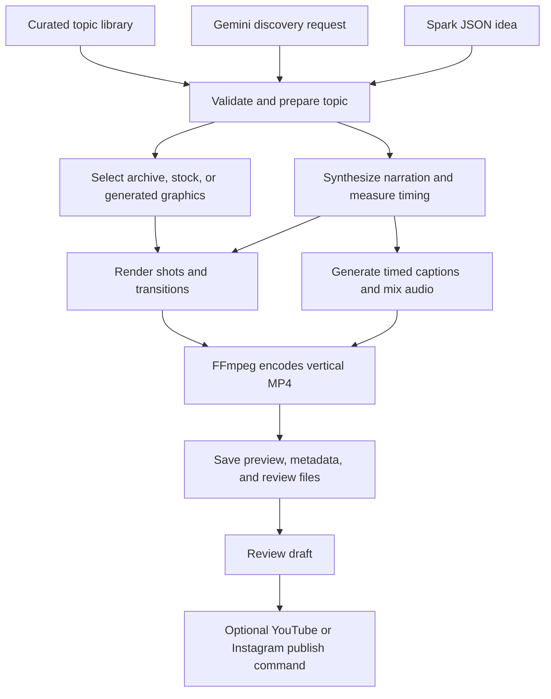

# Auto Video Maker repository guide

## 1. The idea

Auto Video Maker turns a short, sourced story into a vertical video that can be reviewed locally and published to YouTube Shorts or Instagram Reels. A story can come from the curated topic library, a Gemini discovery request, or a structured idea supplied by Spark. The editorial scope covers subjects such as science, history, nature, art, and everyday engineering, with politics and religion excluded from discovery.

The language model supplies the script and visual direction. The local pipeline synthesizes the voice, finds or reads cached media, produces the motion graphics, and encodes the final video. The project is designed to run on a CPU. Optional services have their own quotas and access requirements.

## 2. How a draft moves through the project



1. **Topic and script.** `shorts.py` reads a curated topic or asks Gemini for a structured idea. For discovery it sends a target duration, editorial rules, trend titles when available, and titles to avoid repeating. The response includes the title, narration, labels, source URL, visual beats, an icon query, and event details where applicable. Discovery rejects banned generic openings, normalizes minor beat query/callout formatting drift before validation, supports `--hq-script` (`gemini-4-hydrogen` with fallback to `gemini-3.1-flash-lite`) and `--loop` (seamless ending without the outro follow card), and `spark_job.py` validates a supplied JSON idea and passes it to the same renderer.
2. **Visual selection.** Curated topics can point to reviewed photos and clips. When a discovered story identifies a documented event and year, the search tries event-specific archival media before stock. It prefers relevant clips close to 9:16 and can use landscape clips, stills, or a graphic where available. Pixabay query results are cached for 24 hours (`assets-cache/pixabay_search_cache/`), Pexels is disabled unless `ENABLE_PEXELS=true`, and a single batched Gemini Flash Lite call scores top candidates across all beats for visual relevance. Stock used to illustrate a historical event can carry an on-screen illustration label.
3. **Narration and timing.** Piper or optional Kokoro produces local speech. Captions and visual beats share word-level timings from Faster-whisper or the estimator. The requested duration is a target. A short script can produce a shorter MP4 so the music outro stays brief.
4. **Frames and sound.** Pillow and optional Manim build visuals. Faster-whisper can align words against the audio. The caption module writes ASS subtitles, and FFmpeg burns them into the frames. FFmpeg also mixes narration, music, and sound effects before encoding an H.264 video with stereo AAC.
5. **Draft and review.** Generation saves the MP4, preview, captions, and publishing metadata under a timestamped run folder. Gemini runs also save the actual request and accepted response for inspection. The review queue supports approval and publishing as separate steps. The platform APIs are reached only by publishing flows.

## 3. File structure

```text
Auto video maker/
  shorts.py                   Main CLI and shared draft pipeline
  spark_job.py                Spark JSON entry point
  topics.json                 Curated topic library
  storyboard.py               Shot plans and approved clip catalogue
  production.py               Narrators, palettes, delivery and music choices
  render.py                   CPU narration, frame rendering and final encoding
  archives.py                 Reviewed photo cache
  footage.py                  Reviewed clip cache and decoder
  visuals.py                  Search, rank and cache shot-specific media
  rate_limiter.py             API rate limiting, backoff, and Gemini fallback
  manim_diagrams.py           Optional science animations
  local_secrets.py            Local configuration reader and writer
  local_voices.py             Kokoro and Windows speech helpers
  hindi_captions.py           Shared timed captions and ASS export
  audio_master.py             Music, effects and audio mastering
  youtube.py                  YouTube OAuth and upload
  instagram_publish.py        Instagram account setup and Reel publishing
  queue_publish.py            Review queue, approvals and release controls
  research.py                 Research and topic briefing CLI
  pilot.py                    Earlier cloud publishing pilot
  pilot-progress.json         Cloud pilot progress records
  spark-example.json          Example Spark payload
  setup-publisher.ps1         Windows Task Scheduler setup
  windows-voice.ps1           Windows speech synthesis helper
  requirements.txt            Python dependencies
  README.md                   Setup and operational commands
  PROJECT_GUIDE.md            Architecture and file reference
  .gitignore                  Local file exclusions
  tests/
    test_timed_beats.py       Offline unit tests for timed beats and rendering
  .github/workflows/
    discover-shorts.yml       On-demand discovery and publishing workflow
    spark-render.yml          On-demand hosted Spark workflow
    shorts-pilot.yml          Scheduled or manual cloud pilot workflow
```

### What each source file does

| File | Responsibility |
| --- | --- |
| `shorts.py` | Owns the commands for setup, generation, daily runs, batch publishing (`publish-both`), and upload. Selects topics, calls Gemini where requested (`--hq-script`, `--loop`), normalizes discovery beat fields, checks the structured response, and coordinates visual preparation and rendering. Writes descriptions, tags, and draft metadata. |
| `spark_job.py` | Validates the Spark request identifier, duration, script, citations, and shot fields. Supports validation and local draft mode, plus hosted publication modes when configured. |
| `topics.json` | Stores curated identifiers, titles, narration, source URLs, visual labels, categories, and optional archival image references. |
| `storyboard.py` | Maps topics to layouts and shot instructions. Holds reviewed clip URLs and credits. Exports a human-readable shot and timing brief to `flow-prompt.txt`. |
| `production.py` | Selects palettes, voices, delivery styles, and music arrangements. Holds narration attribution and discovery layout choices. |
| `render.py` | Makes the narration timeline, draws frames at the target resolution, composites photos and video, and applies camera moves and transitions. Feeds frames and audio to FFmpeg and writes a preview image. |
| `archives.py` | Downloads and retrieves explicitly reviewed archival photos for curated topics. |
| `footage.py` | Downloads curated clips and uses FFmpeg to decode footage into frames sized for the compositor. |
| `visuals.py` | Searches Wikimedia Commons, NASA archives, Pixabay (with a 24h search cache), and optional Pexels (`ENABLE_PEXELS=true`). Ranks candidates, runs a batched Gemini Flash Lite visual relevance gate across beats, caches assets by beat ID, reads legacy shot manifests, and can fetch Iconify SVGs. Also handles the optional guarded Pollinations fallback. |
| `rate_limiter.py` | Enforces per-provider request rate limits, retries HTTP 429/5xx responses with backoff, and falls back from `gemini-4-hydrogen` to `gemini-3.1-flash-lite` on quota/rate-limit errors. |
| `manim_diagrams.py` | Provides prewritten science scenes and reusable CPU Cairo templates for timelines, numerical comparisons, and processes. |
| `local_secrets.py` | Reads configuration from the process environment or the ignored `.env` file and writes local values during setup. |
| `local_voices.py` | Downloads and loads optional Kokoro models through ONNX Runtime on CPU. Also calls the Windows speech helper for supported voices. |
| `hindi_captions.py` | Provides shared caption timing and ASS styling for the renderer. Despite its filename, it also handles English captions. It can fall back to estimated word timings if transcription is unavailable. |
| `audio_master.py` | Selects local tracks and effects, can render MIDI arrangements with FluidSynth, and uses FFmpeg to duck music under speech and master the mix. |
| `youtube.py` | Handles Google OAuth credentials, resumable uploads, and local upload receipts. |
| `instagram_publish.py` | Connects a professional Instagram account via its Meta Graph API v27.0 token (resolving the Page and IG business account from `me/accounts` when account IDs aren't explicitly set), builds the Reel caption, uploads the video, and tracks the media container and publication result. |
| `queue_publish.py` | Prepares review drafts, refreshes them, checks approvals against the reviewed files, publishes eligible drafts, and records metrics. |
| `research.py` | Searches NASA media, builds YouTube research watchlists, and exports a topic brief. It is a separate research tool. |
| `pilot.py` and `pilot-progress.json` | Implement and record the earlier cloud pilot with a fixed topic plan and upload checkpoints. |
| `spark-example.json` | Shows the expected JSON format for an externally generated idea. |
| `setup-publisher.ps1` | Registers local Windows scheduled publishing tasks using the selected workflow and options. |
| `windows-voice.ps1` | Synthesizes speech using installed Windows voices for the Python renderer. |
| `requirements.txt` | Lists the shared Python dependencies. Optional Kokoro and Manim can be installed separately. |
| `README.md` and `PROJECT_GUIDE.md` | Cover setup and commands, and the architecture and file map, respectively. |
| `.gitignore` | Excludes credentials, downloaded models and media, local state, and rendered outputs from Git. |
| `tests/test_timed_beats.py` | Runs offline mocked unit tests covering beat validation, discovery normalization, Whisper/estimated timings, visual caching, rendering fallbacks, captions, audio cues, and QA checks. |
| `.github/workflows/discover-shorts.yml` | Runs `shorts.py generate --discover` on demand in GitHub Actions with configurable `count`, `seconds`, `hq_script`, `loop`, and `publish_target` (default `both`), then optionally publishes via `publish-both`. |
| `.github/workflows/spark-render.yml` | Validates an externally submitted idea in GitHub Actions, renders it, and saves an artifact. It can publish with the appropriate configuration and secrets. |
| `.github/workflows/shorts-pilot.yml` | Runs the earlier pilot through GitHub Actions. The workflow file defines manual and scheduled triggers. |

### Local files created during setup or a run

| Path | Purpose |
| --- | --- |
| `.env` and `secrets/` | Local configuration and credentials for APIs and publishing. |
| `voices/` and `voiceovers/` | Downloaded speech models and any local recorded lines. |
| `assets-cache/` | Downloaded photos, clips, shot manifests, 24h Pixabay query cache (`pixabay_search_cache/`), SVGs, audio assets, SoundFont, and caption model assets. |
| `state/` | Worker locks, temporary renders, and persistent local workflow records. |
| `.deps/` or `.venv/` | Local Python dependency installations where applicable. |
| `output/output_<date>_<time>_<microseconds>_IST/` | One run folder, with a subfolder per draft. Existing drafts can also live directly under `output/`. |

A draft folder typically includes `short.mp4`, `preview.png`, `captions.ass`, `metadata.json`, `flow-prompt.txt`, and `research-prompt.txt`. `metadata.json` stores the title, description, tags, target and actual duration, narration timing, source links, and review and synthetic-media flags. Gemini discovery adds `gemini-discovery.json` to each draft and `gemini-requests.json` to the run folder. API credentials are passed separately from the logged request body.

## 4. Technologies by pipeline stage

| Stage | Technology |
| --- | --- |
| Orchestration and data | Python, JSON, Requests, FileLock, and zoneinfo/tzdata for timestamps. |
| Ideas and writing | Gemini API (`gemini-3.1-flash-lite` default, optional `gemini-4-hydrogen` via `--hq-script`) with a JSON response schema and `rate_limiter.py` backoff/fallback, optional Ollama shot planning, curated JSON, and Spark-supplied JSON. Google Trends titles can inform online discovery. |
| Media sources | Wikimedia Commons Action API, NASA Image and Video Library, Pixabay API (24h cached), and optional Pexels API (`ENABLE_PEXELS=true`), filtered in one batched Gemini Flash Lite relevance pass. Iconify provides SVG icons. Pollinations is optional and gated by its configured model and catalog pricing. |
| Narration | Piper TTS, optional Kokoro ONNX with the CPU execution provider, Windows speech through PowerShell, and recorded WAV support. |
| Rendering and animation | Pillow for compositing and procedural drawings, NumPy for audio sample work, resvg-py for SVG rasterization, and optional Manim with Cairo for selected diagrams. |
| Captions | Faster-whisper on CPU, ASS subtitle files, and FFmpeg libass for rendering captions. |
| Music and sound effects | Local audio assets, Mido for MIDI, FluidSynth and a SoundFont for synthesized tracks, and FFmpeg filters for mixing, ducking, and loudness. |
| Final video | FFmpeg via imageio-ffmpeg or a configured binary. Output uses 1080×1920 H.264, stereo AAC, and 30 or 60 FPS. |
| Publishing | YouTube Data API with Google OAuth and resumable upload, and Meta Graph API with a Facebook Page token for Instagram Reels. |
| Execution | Local Windows PowerShell and Task Scheduler or configured GitHub Actions workflows. |

## 5. Timed visual beats

Discovery and modern Spark payloads supply ordered beats with a `beat_id`, an `anchor_text` copied from the narration, a `visual_type`, a focused `search_query`, and an optional `callout_stat`. Targets of 30–45 seconds require five to eight beats. Old Spark payloads and cached three-shot plans still work, and curated topics keep their dedicated scenes.

The renderer matches each anchor in narration order and limits each segment to 4.5 seconds. It can use footage, a photo with a camera move, an animated callout, or a reframed earlier photo. With no icon or usable photo, the renderer can still animate typography and change the card layout. Existing topic-specific Manim scenes are available where applicable. The resolved segment times and rendering choices appear in `metadata.json`.

The active subtitle word uses a contrasting accent for its measured speech interval. Timed cuts can use quiet local whooshes, pops, or an available shutter effect, with space between cues. The actual transition sound timestamps are stored in the draft's audio metadata. Landscape media sits in a rounded frame with a soft shadow over the blurred background, and a thin progress bar tracks the video along the top edge.

A diagram beat can supply a `diagram` object with a `template` of `timeline`,
`comparison`, or `process` and two to four labeled items. It can also specify
a title. A comparison uses numeric `value` fields and an optional shared
`unit`. Manim renders these inserts with Cairo on CPU when installed. Older
diagram beats can use the existing scene or media and animated cards as fallbacks.

Before review, the app records FFmpeg's measured export duration and integrated
loudness under `qa` in `metadata.json`. It flags visual segments longer than
5 seconds, runtime deviations over 25%, and audio outside −16 to −12 LUFS.
The reviewer can inspect the warnings alongside the draft.

## 6. Useful entry points

```powershell
# Generate one offline draft from the curated library
python shorts.py generate --topic wright-first-flight --seconds 18 --offline

# Generate one Gemini discovery draft for local review (or add --hq-script / --loop)
python shorts.py generate --discover --count 1

# Run the offline unit test suite
python -m unittest tests/test_timed_beats.py -v

# Validate a Spark payload
python spark_job.py --mode validate --input spark-example.json

# Inspect the local review queue
python queue_publish.py status
```

See [README.md](README.md) for voice and asset setup, API configuration, and publishing commands.
