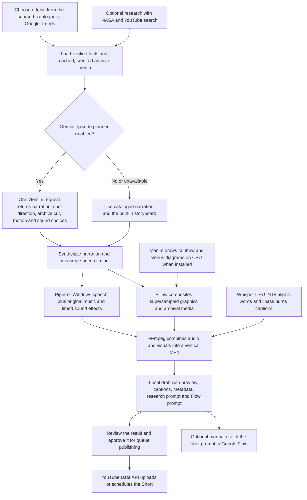

# Auto Video Maker

## CPU video, captions, and audio setup

### Optional Kokoro narration

Kokoro synthesizes English narration locally on CPU. Install the optional
engine and cache the model once:

```powershell
python -m pip install "kokoro-onnx>=0.4.7,<1"
python shorts.py setup-kokoro
$env:SHORTS_KOKORO_VOICE = 'auto'
python shorts.py generate --topic moon-distance --seconds 15 --offline
```

Set `SHORTS_KOKORO_VOICE=auto` in `.env` to use a rotating set of stock voices
for English drafts, or select a voice such as `af_heart`. Clear the setting
to use Piper. Existing regional voice settings take precedence for non-default
English editions. Narration and captions use the same script and timing plan.

The renderer exports 1080×1920 H.264 with stereo AAC (192 kbps target). Set these
in the ignored project `.env`:

```dotenv
USE_LOCAL_GPU=false
SHORTS_FPS=30
```

Use `SHORTS_FPS=60` for smoother motion if the CPU has enough time to render.
The GPU flag is reserved for a future backend. All current rendering, narration,
and transcription run on CPU. Install the Python dependencies and cache the
multilingual Whisper tiny model once:

```powershell
python -m pip install -r requirements.txt
python shorts.py setup-voice
python shorts.py setup-captions
python shorts.py generate --topic venus-spin --seconds 12 --offline
```

`setup-captions` makes the initial download. Subsequent renders use the local
model in CPU INT8 mode and retain the verified script text. When the model is
unavailable, captions use estimated word timings from the narration. FFmpeg
burns in the captions via libass. Each draft also includes its editable
`captions.ass` file. A custom `SHORTS_FFMPEG` binary must include libass and
libx264.

### Local music and sound effects

- Put CC0 or royalty-free MP3/WAV tracks you have permission to publish in
  `assets-cache/music/<soundtrack>/`, using the soundtrack names in
  `production.py` such as `ambient synth` and `felt piano`. Keep license and
  attribution records for the tracks you use.
- If the music cache is empty, the renderer generates a MIDI arrangement with
  a drum groove, syncopated bass, and subtle stereo echo, then
  plays it through FluidSynth and `assets-cache/soundfont.sf2`. The
  [GeneralUser GS SoundFont](https://github.com/mrbumpy409/GeneralUser-GS) is a
  free option. Install [FluidSynth](https://github.com/FluidSynth/fluidsynth/releases)
  on your PATH, set `FLUIDSYNTH_EXE`, or extract its Windows release into
  `assets-cache/fluidsynth/`. PyFluidSynth can also use an installed native
  library. If the SoundFont or runtime is unavailable, narration still renders.
- Put CC0 `whoosh.wav`, `pop.wav`, and `chime.wav` in `assets-cache/sfx/`.
  The [Starter Sound Kit](https://alfredmakes.com/guides/starter-sound-kit/) has
  all three. The renderer levels them and cues them at the opening, reveal,
  and end card. FFmpeg ducks
  the music under the narration and normalizes the mix to a −14 LUFS target.

### Optional visual sources

Cached catalogue media takes priority. To use another asset, search, review
its relevance and license, then run the same command with `--use ID`:

```powershell
python visuals.py venus-spin "Venus atmosphere" --provider nasa
python visuals.py venus-spin "Venus atmosphere" --provider nasa --use REVIEWED_ID
python visuals.py venus-spin "Venus atmosphere" --auto
```

NASA and Wikimedia Commons require no key. `--provider pexels` and `--provider pixabay` use free API
keys named `PEXELS_API_KEY` and `PIXABAY_API_KEY` in `.env`. The selected
asset is cached with its credit and source for offline rendering.
With `--auto`, the tool searches NASA, Commons, and any stock providers with keys
configured. It filters for relevance, then prefers suitable 9:16 footage and
other portrait HD clips. Other clips and photos remain available. Pass `--provider` to
restrict the search. Review automatically selected visuals before posting.

Gemini discovery and Spark can select media for each timed visual beat. They put the results and credits in
`assets-cache/visuals/<topic_id>.json`. A matching Iconify SVG can appear on
fallback cards. Pass `--no-auto-visuals` to use cached assets only. Standard
topic generation stays offline with `--offline`. To render an existing Spark
idea offline, use `python spark_job.py --mode draft --offline --input spark-example.json`.
An explicit `shorts.py generate --discover --offline` still calls Gemini for
the script and skips trends and visual searches.

Video durations are targets. The renderer adjusts speech tempo within a limited
range and reserves the last two seconds for the follow card. When narration
still finishes early, it shortens the export. The target, actual duration, and
narration end time are recorded in `metadata.json`. Successful Gemini discovery drafts
also include `gemini-discovery.json` with the accepted request body and model
response for inspection. The file contains no API key.

Each generation run creates one `output/output_YYYY-MM-DD_HH-MM-SS_microseconds_IST/`
folder. A batch puts all its draft folders under that timestamp. Publishing
commands still accept the individual draft folder name for older and newer drafts.
Gemini batches also include `gemini-requests.json` with the request bodies sent
for each draft, including retries. API keys are kept out of that file.

For a documented event, discovery looks for event-specific archival media first.
If the archive search comes up short, it can use relevant stock footage and labels
that footage as illustrative on screen.

Pollinations is optional. Leave `POLLINATIONS_API_KEY` and
`POLLINATIONS_ZERO_COST_MODEL` blank for the keyless media pipeline. If you
configure them, generation runs only when the live catalog confirms that the
chosen image model has zero rates. This also applies to the manual
`--pollinations-fallback` and `--provider pollinations --use generate`
options. Generated images are credited and flagged as synthetic in metadata.

## How the Shorts pipeline works

To discover a new Short with Gemini across general history, science, arts,
sports, and other subjects, run
`python shorts.py generate --discover --seconds 15`. This uses the configured
Gemini key and recent trend titles from India and the US, avoids previous
titles, and writes a dialogue script and timed Flow prompt. The local
renderer uses Kokoro or Piper and animated graphics. Review the draft and
check the cited article before publishing. Add `--offline` to skip Trends
and ask for an evergreen idea. Discovery still calls Gemini and returns a
proposed source for editorial review.

Use `--seconds 30` through `--seconds 45` to request a longer single discovery
draft with five to eight visual beats. The resolved segments in `metadata.json`
share word timings with the captions and last at most 4.5 seconds each.

For five discovery drafts, run `python shorts.py generate --discover --count 5`.
The app chooses five distinct lengths from 15 to 25 seconds before requesting
the scripts and includes earlier batch titles in its duplicate check.
Gemini acts as the scriptwriter and excludes politics and religion.

To generate five new drafts and publish them publicly to the connected
YouTube channel and Instagram Creator account in one local run:

```powershell
python shorts.py generate --discover --count 5 --publish-both
```

Leave off `--publish-both` to review drafts first. Publish or resume exact
drafts later with `python shorts.py publish-both JOB_FOLDER [JOB_FOLDER ...]`.
Use `--platform youtube` or `--platform instagram` to retry only one
destination. If Meta returns code 190, reconnect with a fresh Page token.
The Instagram caption uses up to five distinct hashtags, including a relevant
matched Google trend when present and topic-specific tags. Google Trends
matches are signals from search, and the app does not measure Instagram
hashtag popularity.

### Spark JSON intake on GitHub

The `spark-render.yml` workflow accepts one idea per GitHub Actions dispatch.
After the workflow is on `main`, callers send an authenticated
`POST /repos/Anmolsarrafbest/auto-video-maker/actions/workflows/spark-render.yml/dispatches`
to `api.github.com`. Use `{"ref":"main","inputs":{"idea_json":"<serialized idea>"}}`.
See [spark-example.json](spark-example.json) for the inner JSON. The endpoint
requires a repository-scoped fine-grained token with **Actions: write**.
Keep that token in the caller's credential store.

Use `source` for a direct citation supporting the narration, from an institution
or publication appropriate to the subject. A modern payload uses a `beats` array
with consecutive integer `beat_id` values, 2–5 word `anchor_text` phrases copied
from the narration in order, a `visual_type` of `archival`, `stock_video`,
`diagram`, or `callout_card`, a 2–4 word `search_query`, and optional
`callout_stat`. The array needs five to eight beats for 30–45 second targets.
An optional `icon_query` takes one or two words. The existing three-shot payload
in `spark-example.json` remains valid. Optional `media_url` and `media_relevance`
can identify an exact Commons photo or clip for the archive beat.

For a Manim insert, set `visual_type` to `diagram` and supply a `diagram`
object. Set its `template` to `timeline`, `comparison`, or `process`, and
provide two to four `items` with short `label` strings. You can add a `title`.
For `comparison`, give every item a nonnegative numeric `value` and use an
optional shared `unit`. Manim is optional and renders these scenes with Cairo.
Drafts include a pre-review report under `qa` in `metadata.json` with measured
runtime, integrated loudness, and any threshold warnings.
GitHub Actions can use the optional repository secrets `PEXELS_API_KEY` and
`PIXABAY_API_KEY`. Keyless sources work with empty secrets.

Set the repository Actions variable `SPARK_RENDER_ENABLED=true` after checking
your included compute and configuring a hard spending stop. The default run creates a private
GitHub Actions draft artifact with one-day retention. To enable publishing, set
`SPARK_PUBLISH_MODE` to `youtube`, `instagram`, or `both`. Configure
`SPARK_YOUTUBE_CHANNEL_ID` and/or `SPARK_INSTAGRAM_ACCOUNT_ID` plus
`SPARK_INSTAGRAM_USERNAME` as Actions variables, and set the corresponding
`YOUTUBE_TOKEN_JSON` or `INSTAGRAM_PAGE_ACCESS_TOKEN` as Actions secrets.
The cloud runner uses CPU-only Kokoro. Without cached music or a SoundFont,
the render uses narration audio. Credentials stay in Actions secrets.

### Before making the repository public

- Copy `.env.example` to a local `.env` for development. Store live API keys,
  credentials and tokens in Actions secrets for hosted runs.
- Review Git history, Actions logs, artifacts, and release attachments before
  switching visibility. Rotate any credential that has previously been shared.
  [GitHub's visibility checklist](https://docs.github.com/en/repositories/managing-your-repositorys-settings-and-features/managing-repository-settings/setting-repository-visibility)
- Public Spark runs default to draft mode even if `SPARK_PUBLISH_MODE` is set.
  Public publishing requires `SPARK_PUBLIC_PUBLISH_ENABLED=true`.
  Public preview artifacts require `SPARK_SAVE_PUBLIC_ARTIFACTS=true`.
  Use Actions secrets for account identifiers if you prefer to mask them in logs.
- The earlier scheduled YouTube pilot requires `SHORTS_PILOT_ENABLED=true`
  and a configured `PILOT_YOUTUBE_CHANNEL_ID`. Leave the pilot disabled for
  a public source release unless you intend to resume its fixed upload plan.

```powershell
python spark_job.py --mode validate --input spark-example.json
$request = @{ ref = 'main'; inputs = @{ idea_json = (Get-Content .\spark-example.json -Raw) } } |
    ConvertTo-Json -Depth 4 -Compress
$request | gh api --method POST repos/Anmolsarrafbest/auto-video-maker/actions/workflows/spark-render.yml/dispatches --input -
```

Give each idea a unique `request_id` and reuse the same ID for any retry. Before
publishing, the worker reserves the ID with a repository tag to prevent duplicate
uploads. If publication fails after a reservation, check both platforms before
any manual retry. The intake validates the category and citation URL format.
Verify the scientific claim and asset context before enabling public
publishing. Google documents Spark custom external apps as MCP connections
with regional and write-confirmation requirements.
[Spark custom app requirements](https://support.google.com/gemini/answer/17209137?hl=en)
[GitHub workflow dispatch API](https://docs.github.com/en/rest/actions/workflows#create-a-workflow-dispatch-event)



Generate vertical science Shorts with an episode-specific duration and shot plan. Use `--seconds` to override the default (10, 12, 15, 18, 20, or 25), provided the script fits. Draft generation works without a Gemini key or a YouTube account. Uploading uses the free YouTube Data API after you connect your channel.

Quiz Shorts ask a question, say “Think about it,” then wait 1.5 seconds. Science-history stories, myth checks, and visual demonstrations use different timing. Archive, laboratory, observatory, and ocean treatments use different palettes and custom illustrations. The app selects one of three local Piper voices and composes an instrumental score for each episode. The exported Flow prompt and upload metadata record the selected treatment and narration credit.

## Run locally on Windows

From this folder in PowerShell, using Python 3.11 or newer on 64-bit Windows:

```powershell
python -m pip install --target .deps -r requirements.txt
python shorts.py setup-voice
python shorts.py generate --topic venus-spin --seconds 12 --offline
```

The first two commands download open-source dependencies and three English Piper voice models, including Scottish and U.S. English narrators. The Python package supplies FFmpeg. `setup-voice` saves each pinned model card, and video descriptions credit the voice used.

Topics can use `en-IN` with the installed Windows English (India) voice Microsoft Heera. Hindi production is paused. The recorded-narration and Devanagari caption support is retained for later.

Run `python shorts.py setup-footage` to cache the reviewed lunar and Mars assets. The Moon episode uses a credited NASA SVS turntable followed by an original 3D-projected diagram. The Mars episode opens with an edited camera sequence from Curiosity, followed by an original explanation. The storyboard export includes shot timing, framing, narration timing, and factual constraints for Flow. The renderer can run offline after asset setup.

### Free research before rendering

```powershell
python research.py brief mars-sunset
python research.py nasa "Mars sunset" --limit 5
python research.py youtube "Mars blue sunset" --region IN --days 90
python shorts.py generate --offline --topic mars-sunset
```

The brief estimates pacing from the script. NASA search lists candidate archive pages without a key. Review each asset's credit and terms before adding it to the renderer's footage catalogue. YouTube search uses the existing Google sign-in or an optional `YOUTUBE_API_KEY` and displays public titles, dates, and view counts without downloading creator footage. The results are short-duration matches and can include regular videos. US and India can be queried separately. No paid research service is required.

History topics can use an archival photograph from a catalogue entry in `topics.json`. The entry records the real image, its archive page, its credit, and its caption. Download the verified files once, then the renderer can use the cache offline:

```powershell
python shorts.py setup-assets --topic katherine-johnson --topic wright-first-flight
```

Run `python shorts.py setup-assets` to try all the listed archives. If a source is unavailable, the video uses its original diagram and leaves the image credit out. When footage is available, the opening photo is identified on screen, followed by the original explanatory animation. Check usage terms before adding a new archive entry.

Open the printed `short.mp4` path. The same folder contains `preview.png`, `metadata.json`, and `flow-prompt.txt`. The Flow prompt is optional and can be pasted into Google Flow manually.

```powershell
python shorts.py generate --seconds 15 --region IN
python shorts.py daily --count 2 --seconds 12 --region IN
```

`generate` tries Google Trends and renders one draft. `daily` creates dated slots in India time by default. Re-running it on the same date reuses the existing slots. The worker only picks exact matches from its sourced science, space, and ocean topic library. Without an eligible match, it picks an unused evergreen topic. Add fresh entries to [topics.json](topics.json) when the library runs out. Each entry needs a unique ID, factual source, two short narration beats, two labels, and one of the existing scene names. Political and religious topics should stay outside the library.

## Optional Gemini drafts

Use this only if you have a separate Gemini API key from a project on the free tier with billing disabled. Your Jio Google AI Pro chat and Flow access work independently of the API.

Set `GEMINI_FREE_API_KEY` in your shell or save it in the ignored project `.env` file:

```powershell
python -c "from getpass import getpass; from local_secrets import store_secret; store_secret('GEMINI_FREE_API_KEY', getpass('Gemini API key: ').strip())"
```

Then run:

```powershell
python shorts.py generate --topic saturn-rings --seconds 15 --gemini
```

Gemini rewrites the narration using the sourced fact supplied by the app. Review the result before upload. Daily jobs use the curated scripts and need no Gemini key. [Gemini API pricing](https://aistudio.google.com/docs/pricing#gemini-3.5-flash-lite)

## Connect YouTube and test a private upload

1. In [Google Cloud Console](https://console.cloud.google.com/), create a project and enable **YouTube Data API v3**. This uses an API project for authentication, with no Cloud Run deployment, VM, paid model, or billing setup needed for this app.
2. Configure the OAuth consent screen. For external Testing, add the Google account that owns the channel as a test user. Create a **Desktop app** OAuth client and download its JSON.
3. Run `python shorts.py connect-youtube --client "C:\path\to\downloaded-client.json"` with the actual downloaded file path, and sign in to the intended channel. You can also save the file as `secrets/youtube-client.json` and omit `--client`. Copy the channel ID shown in the terminal. Tokens stay in `secrets/`.
4. Review the draft and its metadata, including the audience and synthetic content settings. Use the printed output folder name in the example below.

```powershell
python shorts.py upload 'venus-spin-REPLACE_WITH_ACTUAL_SUFFIX' --visibility private
```

For a Gemini draft, add `--reviewed` after checking its facts and narration. Uploads default to private. If an upload is interrupted, rerun with the same job, visibility, and metadata. The app saves the resumable session and then the YouTube video ID. If a session expires, check YouTube Studio before clearing the local record. A private test job stays associated with that upload. You can change its visibility directly in Studio.

External OAuth consent screens in Testing issue refresh tokens that usually expire in seven days. For recurring use, switch the app to In production as appropriate for your account and Google’s OAuth requirements, then reconnect. See [Google OAuth refresh token expiration](https://developers.google.com/identity/protocols/oauth2#expiration).

## Run on a schedule

Each upload includes a question headline, a short explanation, a source link, and topic-specific tags and hashtags. For every new draft, the app checks Google Trends in the U.S. and India, plus the selected region if different. It adds a trend to the description only when it matches a vetted alias for that topic. The standard hashtags are used when there are no matches, a feed is unavailable, or you pass `--offline`. Review or edit the draft's `metadata.json` before starting its upload.

After connecting the channel, register the daily Windows task from PowerShell. The first example uses private visibility. After verifying a private upload in YouTube Studio, run the second command to switch the schedule to public:

```powershell
powershell -NoProfile -ExecutionPolicy Bypass -File .\setup-publisher.ps1 -At 18:30 -Count 1 -Seconds 15
powershell -NoProfile -ExecutionPolicy Bypass -File .\setup-publisher.ps1 -At 18:30 -Count 1 -Seconds 15 -Visibility public
```

The second registration replaces the first schedule. The PC needs to be on with your Windows user signed in. Use `-Count 2` to upload two videos in the same daily run. Use `-WhatIf` to preview the schedule, or disable **Auto Video Maker - YouTube Shorts** in Task Scheduler to pause future runs. If you already ran today's slots privately, the public schedule applies to new slots. You can change a private video's visibility directly in YouTube Studio.

To run the daily publisher manually:

```powershell
python shorts.py daily --count 1 --seconds 12 --upload public --channel-id 'UC_REPLACE_WITH_YOUR_CHANNEL_ID'
```

Use `--count 2` for two slots per run. Keep `--upload private` for continued private testing or omit `--upload` for local drafts. Review the applicable defaults in each draft’s `metadata.json`. The standard renderer produces stylized illustrations for a general audience.

If an upload fails, rerun the task on the same day, or resume an older job explicitly with `upload`.

The project is local. Credentials, generated videos, voice files, and upload records are ignored by Git. Keep those files on the same machine so daily counts, the used-topic history, and upload resumption survive restarts.

## No-bill publishing queue

Run the queue on your Windows PC. It uses local Piper narration, audio, illustrations, and FFmpeg. GitHub stores the code. The hosted pilot is paused. To resume its remaining topics locally, prepare them for review:

```powershell
python queue_publish.py prepare --topic rainbow-split --topic moon-distance --topic mars-sunset
python queue_publish.py status
```

Use `python queue_publish.py prepare --count 4` to prepare a mixed batch of unused topics. Preview each MP4 in `output/` and confirm its factual claim, source, and visuals. Approve individual drafts after checking them. Editing the video or metadata clears the effective approval until you approve again.

To update older unpublished drafts after installing the voice set, run `python queue_publish.py refresh`. Older media and any prior approvals are saved in `state/previous-renders/`. Review the new version as its own draft. At review time, check that the explanation or demonstration teaches something distinct. A change of voice, music, or colors alone is not an editorial reason to publish.

```powershell
python queue_publish.py approve queue-katherine-johnson
python queue_publish.py publish --count 1 --visibility public --channel-id 'YOUR_CONNECTED_CHANNEL_ID'
```

For daily uploads from the approved queue, use the Windows scheduler installer with `-Queue`. The PC needs to be on and signed in. The scheduler skips drafts that still need review.

```powershell
powershell -NoProfile -ExecutionPolicy Bypass -File .\setup-publisher.ps1 -Queue -At 18:30 -Count 1 -Visibility public
```

Start with at most one approved public Short a day. Skip days when a draft needs more work. After 10–15 releases, compare their viewer retention and decide which topics and formats merit more episodes. Keep this on your PC while the budget is zero. Archive credits, sensible pacing, and editorial review reduce risk, but there is no guaranteed strike-free cadence. [YouTube spam policy](https://support.google.com/youtube/answer/2801973)

Record YouTube Studio metrics at the same age after upload so you can compare formats in `status`. Use your actual numbers:

```powershell
python queue_publish.py metrics queue-katherine-johnson --age-hours 48 --stayed 55 --average 81 --engaged 120
```

For strict zero GitHub runner spend, keep the cloud workflow disabled. If you later want to run hosted Actions, first check [GitHub Billing](https://github.com/settings/billing). GitHub blocks overages when the account has no valid payment method. If you use a payment method, verify an Actions budget with **Stop usage when budget limit is reached** before enabling hosted runs. [GitHub Actions billing](https://docs.github.com/en/billing/concepts/product-billing/github-actions) · [GitHub budget settings](https://docs.github.com/en/billing/how-tos/set-up-budgets)

## Five-Short cloud pilot

The private GitHub repository's **Five-Short cloud pilot** workflow tests the uploader on a hosted Linux runner. It is specific to the Skill_issue channel and uses the repository Actions secret `YOUTUBE_TOKEN_JSON`. The Git history contains only pilot topic IDs, dates, and public video IDs. Keep the secret out of source control.

When enabled, the pilot can run on demand or around 6:37 p.m. India time, uploads at most two public Shorts per India calendar day, and disables itself after five. See `pilot-progress.json` for completed uploads. A reservation with no video ID stops further uploads until the channel owner checks YouTube Studio and reconciles the record. This protects against a second upload after a runner interruption. Finish the outstanding topics through either the local queue or the hosted pilot, since they use separate upload records.

## Prepare Instagram Reels

The local publisher uses **Instagram API with Facebook Login** so it can send local MP4 files directly. Create an Instagram profile, switch it to a **professional Creator** account, and link it to a free Facebook Page you manage. Create a Meta developer app with the Instagram API with Facebook Login publishing use case. Use a Page access token for the linked Page and the numeric Instagram professional account ID returned by `instagram_business_account`. Follow Meta’s current steps and permission requirements for the app mode you use. [Meta setup](https://developers.facebook.com/documentation/instagram-platform/instagram-api-with-facebook-login/get-started) · [Meta Reels publishing](https://developers.facebook.com/documentation/instagram-platform/content-publishing)

```powershell
python instagram_publish.py preview queue-katherine-johnson
python instagram_publish.py connect --account-id YOUR_NUMERIC_ID --username YOUR_PROFILE_NAME
python instagram_publish.py approve queue-katherine-johnson
python instagram_publish.py publish-next
```

Enter the Page token at the hidden prompt. It is saved as `INSTAGRAM_PAGE_ACCESS_TOKEN` in the ignored project `.env` file. The Instagram account ID and username are stored in `secrets/instagram.json`. YouTube OAuth sign-in saves the channel and credentials as `YOUTUBE_TOKEN_JSON` in `.env`. Review the video in the local queue first, then approve it explicitly for Instagram. `publish-next` can publish one approved Reel per India calendar day. It publishes immediately when Meta finishes processing. Start with one manual test, then use Windows Task Scheduler to run `python.exe` with the absolute path to `instagram_publish.py` and argument `publish-next`. Use the project folder for **Start in**. The PC must be on and signed in. If an earlier publish has an uncertain outcome, reconcile it on the Instagram profile before changing the local receipt.

From the repo, register the Instagram task with:

```powershell
powershell -NoProfile -ExecutionPolicy Bypass -File .\setup-publisher.ps1 -Instagram -At 19:15
```

Use the YouTube `-Queue` task to publish the same reviewed drafts on both
platforms. Register separate start times because both commands share a local
publishing lock. The non-queue YouTube task can generate its own draft and
publish directly. Add `-Offline` to that task to skip trend lookup during
generation. Uploads still require the internet. Add `-WhatIf` to preview
either registration.
# Optional Manim science diagrams

Install Manim Community to use CPU-rendered animations for the rainbow and Venus Shorts.
The main renderer adds the diagram at the narration reveal and keeps the existing
captions, music, sound cues, and end card.

```powershell
python -m pip install manim==0.22.1
python shorts.py generate --topic rainbow-split --offline
```

The job's `metadata.json` records the diagram renderer and a suggested
`pinned_comment` for manual posting. It does not post the comment.
Manim also animates Mercury's solar day, lunar eclipses, Saturn's rings,
and the forces in a white dwarf. The white dwarf scene is available for the
catalogue's Hindi draft when Hindi production resumes. These topics use
their built-in illustrations when Manim is absent.
